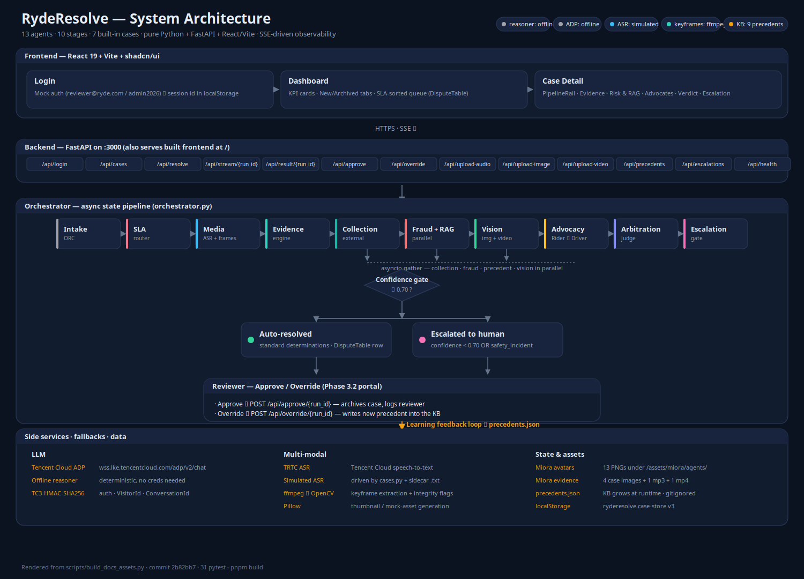

# RydeResolve — Multi-Agent Autonomous Dispute Resolution

> A multi-agent arbitration backend + live observability console for ride-hailing
> disputes. Built for the **Tencent Cloud AI Singapore Hackathon 2026** (Ryde
> problem statement) on the AI Agent Digital Native track.

## What it solves

Ride-hailing platforms process thousands of dispute tickets a day — fare
disputes, route deviations, no-show charges, property damage. Today every one
of them waits 24–72 hours for a human agent to read GPS pings, chat logs and
photos, then write up a ruling. RydeResolve replaces that with an **explicit,
auditable, state-pipelined multi-agent system** that issues a defensible ruling
in under a second and falls back to a human reviewer when the evidence is thin.

## Architecture



The diagram above is the canonical view: frontend (Login → Dashboard → Case
Detail) → 13 FastAPI endpoints → 10-stage async state pipeline in
`orchestrator.py` → confidence gate → either auto-resolved or escalated to a
human reviewer → Approve / Override → learning feedback loop into
`precedents.json`. Source-of-truth: `scripts/build_docs_assets.py`.

Pipeline order: **intake → SLA routing → media ingestion (ASR + keyframes) →
evidence → external collection (parallel) → fraud + precedent (parallel) →
vision → parallel advocacy → arbitration → escalation gate**, with the
override endpoint closing the loop back into the precedent knowledge base.

## Project layout

```
backend/
  main.py            FastAPI app, /api + / routes, CORS, optional static
  config.py          12-factor settings (env-driven)
  models.py          Pydantic v2 schemas (SLA, risk, precedent, wire contracts)
  prompts.py         Agent system prompts + JSON output contracts
  evidence.py        Deterministic fact extraction (the auditable core)
  agents.py          SLA router, collection agent, fraud agent, precedent RAG
  adp_client.py      LLMProvider protocol, ADP SSE client, OfflineReasoner
  orchestrator.py    Async state pipeline, run broker, SSE generator, overrides
  cases.py           DISP-001..007 sample datasets (4 historical + 3 incoming)
  data/precedents.json  precedent knowledge base (gitignored, grows at runtime)
  trtc_client.py     TRTC ASR + simulated fallback, hostility scoring
  vision_utils.py    ffmpeg→OpenCV keyframe extraction + integrity signals
  media_store.py     upload persistence + MIME routing
frontend/
  src/
    pages/Index.tsx          main case-detail page (pipeline rail, evidence, advocates, verdict)
    pages/Dashboard.tsx      Reviewer Portal — KPI cards, New/Archived tabs, SLA-sorted queue
    pages/Login.tsx          Mock auth screen (reviewer@ryde.com / admin2026)
    pages/NotFound.tsx
    components/CaseRail.tsx          left rail
    components/PipelineRail.tsx      10-stage progress rail
    components/AgentStream.tsx       live SSE feed
    components/EvidencePanel.tsx     facts + policy + risk + vision + media players
    components/RiskPanel.tsx         SLA routing, collection, fraud, precedents
    components/AdvocatesPanel.tsx    rider vs driver cards
    components/VerdictPanel.tsx      ruling + confidence + summaries
    components/EscalationPanel.tsx   escalation packet + Approve/Override
    components/DisputeTable.tsx      SLA-sorted queue rows (New + Archived)
    components/CasePersistenceContext.tsx  per-case localStorage cache
    components/ReviewerNav.tsx       status pills (reasoner/ADP/keyframes/ASR/KB) + reviewer badge
    components/agent-meta.ts         shared color/metadata + Miora avatar paths
    types/index.ts                   mirror of backend schemas + STAGES
    lib/api.ts                       typed API + EventSource client
  public/assets/miora/             Miora case images, audio, video
  public/assets/miora/agents/      13 Miora-generated agent avatars
```

## Running it

### 1. Backend

```bash
cd backend
pip install -r requirements.txt
cp .env.example .env          # optional — leave ADP_APP_KEY empty for offline
python -m uvicorn main:app --host 0.0.0.0 --port 3000
```

You should see:

```
INFO uvicorn.error | Application startup complete.
INFO ryderesolve | ADP_APP_KEY not set — running the deterministic offline reasoner.
INFO ryderesolve | Serving built frontend from .../frontend/dist  (if built)
```

### 2. Frontend (dev)

```bash
cd frontend
pnpm install
pnpm dev          # http://localhost:5173
```

Vite proxies `/api/*` to `http://localhost:3000`.

### 3. Single-port deploy

```bash
cd frontend && pnpm build
cd ../backend && python -m uvicorn main:app --port 3000
# Open http://localhost:3000
```

When `frontend/dist` exists the FastAPI app mounts it at `/` and serves the
whole product from one process.

## Talking to it by hand

```bash
# 1. List the built-in disputes
curl -s http://localhost:3000/api/cases | jq

# 2. Open the official hackathon sample
curl -s -X POST http://localhost:3000/api/dispute \
  -H "Content-Type: application/json" \
  -d '{"case_id":"DISP-002"}' | jq

# 3. Watch the agents talk (Server-Sent Events)
curl -N http://localhost:3000/api/stream/<run_id>

# 4. Read the final ruling + evidence
curl -s http://localhost:3000/api/result/<run_id> | jq

# 5. Human override — writes the correction back as a precedent (learning loop)
curl -s -X POST http://localhost:3000/api/override/<run_id> \
  -H "Content-Type: application/json" \
  -d '{"reviewer_id":"ops-1","decision":"partial_refund","amount":12.5,
       "rationale":"Telemetry shows the driver waited less than the full window."}' | jq

# 6. Inspect the knowledge base and the escalation queue
curl -s http://localhost:3000/api/precedents | jq
curl -s http://localhost:3000/api/escalations | jq

# 7. Attach a covert audio recording to a safety case (TRTC ASR runs on it)
curl -s -X POST http://localhost:3000/api/upload-audio \
  -F "case_id=DISP-006" \
  -F "captured_at=2026-09-18T23:41:00+08:00" \
  -F "transcript_hint=driver: I will find you after this trip, I know where you live!" \
  -F "file=@backend/data/uploads/samples/disp006_argument.wav" | jq

# 8. Attach a dashcam clip — ffmpeg extracts keyframes at 1 fps automatically
curl -s -X POST http://localhost:3000/api/upload-video \
  -F "case_id=DISP-007" \
  -F "captured_at=2026-09-20T21:36:00+08:00" \
  -F "file=@backend/data/uploads/samples/disp007_cabin.mp4" | jq

# 9. Re-run the safety case — the new transcript now flows into the ruling
curl -s -X POST http://localhost:3000/api/resolve -H "Content-Type: application/json" \
  -d '{"case_id":"DISP-006"}' | jq '.ruling | {decision, escalated, key_findings}'
```

## Why an "evidence-first" design?

The Ryde problem statement calls out **inconsistent rulings** as a core pain
point. Letting the LLM invent facts from raw JSON does not solve that — it
embeds the inconsistency inside an opaque model.

So the evidence layer (`backend/evidence.py`) is the *only* thing that touches
the numbers:

* Haversine distance between every GPS ping and the pickup pin
* Wait duration, contact attempt count, pickup drift, route deviation vs. optimal
* EXIF-vs-trip-end delta, AI-generation probability, fare overcharge
* Per-claim policy compliance (CANCEL-1..5, ROUTE-1..3, DAMAGE-1..2)

Every output fact carries a `source` and a `supports` party tag. The
advocates and the judge are *only* allowed to argue over those facts, and
must cite fact keys in their output. A reviewer can replay the arithmetic
for any ruling and explain to the rider *exactly* why they won or lost.

When Tencent Cloud ADP is unreachable (or no AppKey is configured), the
`OfflineReasoner` produces the same shape of output deterministically from
the same evidence packet, so the system is demoable end-to-end without
credentials — and so it can be A/B-tested against a baseline ruling
("responsible AI" criterion).

## Expected rulings for the built-in samples

| Case       | Category        | Priority | Expected ruling                                     |
| ---------- | --------------- | -------- | --------------------------------------------------- |
| `DISP-001` | Route Deviation | normal   | **PARTIAL REFUND** — ~$5.60 (traffic justified part) |
| `DISP-002` | No-Show Charge  | normal   | **CHARGE UPHELD** — driver met every policy clause   |
| `DISP-003` | Property Damage | high     | **NO ACTION** + escalated to Fraud & Safety (fake photo) |
| `DISP-004` | Property Damage | high     | **COMPENSATE DRIVER** — $60 cleaning fee awarded      |
| `DISP-005` | Safety Incident | critical | **ESCALATED TO HUMAN** — never auto-resolved          |
| `DISP-006` | Safety Incident | high     | **ESCALATED TO HUMAN** — heated cabin-temperature argument, no explicit threat |
| `DISP-007` | Safety Incident | critical | **ESCALATED TO HUMAN** — instant suspension, safety ticket, law-enforcement referral |

## Stretch goals implemented

* **SLA & Routing Manager** (`agents.py`) — tags every ticket with a
  `sla_priority` (critical/high/normal/low), a queue and an SLA due time
  *before* arbitration starts. `safety_incident` and high-value claims are
  fast-tracked; `DISP-005` lands in the `safety_escalations` queue as CRITICAL.
* **Evidence Collection Agent** — an async fan-out that "queries" five upstream
  services (trip, telemetry, messaging, mobile analytics, identity), reporting
  per-source latency, record counts and degraded/failed status. It is a
  data-ingestion orchestrator, not a text generator.
* **Fraud & Bad-Faith Detection Agent** — scores `fraud_flags` +
  `dispute_history` + evidence contradictions into a `FraudAssessment`
  (risk score, verdict, per-party risk, `RiskSignal[]`) and hands it straight
  to the judge.
* **Policy & Precedent Agent** (mock RAG) — retrieves the top-k analogous past
  rulings by fact-signature similarity and tells the judge how to stay
  consistent; the knowledge base is a JSON store that grows at runtime.
* **Escalation Protocol** — a gate right after the judge: confidence below
  `CONFIDENCE_ESCALATION_THRESHOLD` (default 0.70) or an always-human dispute
  type halts autonomy, sets `escalated_to_human` and emits a full
  `EscalationPacket` (routing, evidence digest, conflicts, risk flags,
  recommended focus).
* **Learning Feedback Loop** — `POST /override/{run_id}` captures a reviewer's
  decision and injects it into the precedent knowledge base as a new
  `human_override` precedent, so the next analogous dispute is arbitrated
  against what the reviewer actually decided. The UI shows the new precedent id
  and the growing KB size.

All six agents emit events on the SSE stream, and the console renders them in
the 10-stage pipeline rail and the **Risk & RAG** tab.

## Phase 3: multi-modal evidence pipeline

The dispatcher now accepts **secret audio recordings** and **dashcam / damage
clips** as first-class evidence. Two new agents and three new backend modules
power them:

* **TRTC Speech-to-Text** (`trtc_client.py`) — Tencent Cloud TRTC ASR with
  TC3-HMAC-SHA256 signing. Falls back to a deterministic simulated client when
  credentials are absent (CI / demo). Scores each transcript 0–1 for
  hostility, flags explicit threats (`"I know where you live"`,
  `"break your phone"`, …) and segments the audio into timestamped
  rider/driver turns.
* **Keyframe Extraction** (`vision_utils.py`) — `ffmpeg` + `ffprobe` first,
  OpenCV fallback. Samples 1 frame per second, computes per-frame luminance
  and motion, and surfaces integrity anomalies (very dark clip, near-identical
  frames → looped or frozen). Resulting `VideoAnalysis` carries frames,
  duration, engine and `severity` back to the Vision Agent.
* **`/upload-audio` & `/upload-video`** (FastAPI) — park uploaded payloads in
  `data/uploads/...` and graft them onto the matching case dossier on the next
  run, so the Judge, Fraud Agent and Advocates see the real file. Optional
  `transcript_hint` is a deterministic knob for the simulated ASR.

Two new sample cases exercise the new agents end-to-end:

| Case | Type | Pipeline | Expected ruling |
|------|------|----------|-----------------|
| `DISP-006` | `safety_incident` (verbal, AC argument) | TRTC ASR transcribes an 8 s covert recording into 3 turns (rider / rider / driver) on cabin temperature; hostility high, no explicit threat. | **ESCALATE TO HUMAN** (mandatory under policy `SAFETY-1/2`) |
| `DISP-007` | `safety_incident` (physical/sexual harassment) | 12 s low-light cabin video decoded into 12 keyframes; night footage integrity flag, physical-contact anomaly across frames. | **ESCALATE TO HUMAN** — instant driver suspension, safety ticket, law-enforcement referral |

All thirteen agents now emit on the SSE stream and the console renders them in the
**10-stage** pipeline rail (the new `Media Ingestion` stage sits between SLA
routing and evidence extraction). The Evidence tab adds:

* a real `<video controls>` player with the Miora poster image, the clip's
  duration/source fps, frame count and engine, and a clickable 4-column
  keyframe strip that enlarges on click;
* a real `<audio controls>` player with per-turn transcript cards (speaker
  chip, timestamps, hostility score, threat text highlighted red), keyword
  chips and a one-line summary;
* a "Submit your own payload" box that posts to `/upload-audio` and
  `/upload-video`;
* Miora-generated avatars for every agent role (13 PNGs under
  `frontend/public/assets/miora/agents/`), including the new
  `asr.png` for the TRTC stage.

## Phase 3.2: Human Reviewer Portal

A role-based interface for operations reviewers, sitting on top of the
multi-modal pipeline. Login, then the dashboard, then a case detail view
with Approve / Override tied to the Learning Feedback Loop.

* **Auth (mock)** — `/login` accepts `reviewer@ryde.com` / `admin2026` and
  returns a session id stored in `localStorage`. The top nav shows the
  reviewer badge and a sign-out button.
* **Automated background arbitration** — the dashboard's `New` tab
  auto-runs any unresolved case in the background; the row dot cycles
  `pending` → `processing` → `resolved` / `escalated` and is replaced by
  the verdict once cached.
* **SLA + value-based queue** — `DisputeTable.tsx` sorts by `sla_priority`
  (`critical` > `high` > `normal` > `low`) then `financial_value` desc,
  and surfaces red escalation badges, AUDIO/VIDEO/IMAGE chips, and the
  four KPI cards (Escalated / Critical / Awaiting review / Closed &
  Archived).
* **Two sections, not one** — "Action Required: Escalated Cases" sits
  above "Standard Agent Determinations (Awaiting Review)".
* **Approve / Override** — `EscalationPanel.tsx` calls
  `POST /api/approve/{run_id}` (one-click close + audit row) or
  `POST /api/override/{run_id}` (modal: pick alternative ruling + free
  text, writes a new precedent into the KB and returns the new KB size).
  The case moves to the **Archived** tab with a full audit row.
* **State persistence** — `CasePersistenceContext.tsx` caches per
  `case_id` (storage key `ryderesolve.case-store.v3`): full SSE event
  log, telemetry facts, vision findings, both advocate arguments, judge
  verdict + confidence, escalation packet, audio/video keyframe state.
  Switching tabs / cases restores instantly with no re-run.
* **Archived UX** — the Archived view shows the reviewed-verdict badge
  (`Approved by … · YYYY-MM-DD` / `Overridden by …`) rather than a
  "Re-run Arbitration" button, so reviewers see exactly the version the
  human reviewer reviewed.
* **Status pills at the top** — `reasoner` (offline/adp), `ADP` (offline
  / configured), `KB` (precedent count), `keyframes` (ffmpeg/opencv),
  `ASR` (trtc/simulated). These are deliberate, not errors — the
  offline reasoner is the intended demo path.

## Build log

A consolidated record of every phase's intent, what was shipped, the
latest fixes, and the open gaps lives in [`docs/BUILD_LOG.md`](docs/BUILD_LOG.md).

### Testing

```bash
# 31-test regression suite (ASR scoring, keyframe extraction, upload
# endpoints, DISP-006/007 end-to-end, 7-case regression, Miora asset audit)
# IMPORTANT: run from inside backend/ — cases.py resolves Miora asset paths
# relative to the cwd.
cd backend && python3 -m pytest tests -q

# Headless Chromium smoke: video player renders, keyframes decode, audio
# player renders, all Miora avatars load, no JS errors
cd /workspace && python3 scripts/ui_smoke.py
```

`scripts/generate_mock_assets.py` produces the audio WAV, MP4 and the Miora
asset PNGs deterministically (Pillow + ffmpeg), so the test suite and the UI
work without any external network calls.

## Environment

| Variable                         | Default | Purpose                                          |
| -------------------------------- | ------- | ------------------------------------------------ |
| `ADP_APP_KEY`                    | (empty) | Tencent Cloud ADP credential; empty = offline    |
| `ADP_ENDPOINT`                   | `https://wss.lke.tencentcloud.com/adp/v2/chat` | ADP chat URL     |
| `ENGINE_MODE`                    | `auto`  | `auto` / `adp` / `offline`                       |
| `CONFIDENCE_ESCALATION_THRESHOLD`| `0.70`  | Below this confidence the judge is overridden    |
| `AUTO_ESCALATE_DISPUTE_TYPES`    | `safety_incident` | Comma-separated dispute types always escalated |
| `OFFLINE_DEMO_PACING_MS`         | `220`   | Per-step delay for the offline reasoner (demo only) |
| `SLA_HIGH_VALUE_THRESHOLD`       | `50`    | Claim amount (SGD) that promotes a ticket to HIGH |
| `COLLECTION_SIMULATE_LATENCY`    | `true`  | Emulate upstream API round-trips in the collection agent |
| `COLLECTION_BASE_LATENCY_MS`     | `40`    | Base latency per upstream call                   |
| `COLLECTION_JITTER_MS`           | `90`    | Random jitter added per upstream call            |
| `PRECEDENT_TOP_K`                | `2`     | Precedents retrieved per dispute                 |
| `PRECEDENT_STORE_PATH`           | (none)  | JSON file backing the knowledge base (persists across restarts) |
| `PORT`                           | `3000`  | HTTP port                                        |
| `TRTC_SECRET_ID` / `TRTC_SECRET_KEY` | (empty) | Live TRTC ASR; empty = simulated client       |
| `TRTC_APP_ID`                    | (empty) | TRTC application id (optional)                  |
| `TRTC_ASR_ENDPOINT`              | `https://asr.tencentcloud.com` | TRTC ASR endpoint             |
| `TRTC_TIMEOUT_S`                 | `30.0` | TRTC request timeout                           |
| `MEDIA_DIR`                      | `data/uploads` | Where uploaded audio/video are parked    |
| `FRAME_DIR`                      | `data/frames`   | Where extracted keyframes are written   |
| `VIDEO_FRAME_FPS`                | `1.0`   | Keyframe sampling rate                           |
| `VIDEO_MAX_FRAMES`               | `12`    | Cap on frames per clip (keeps the UI snappy)     |

## Submitting to the hackathon

* Project title: **RydeResolve**
* Short blurb: *Multi-agent autonomous dispute resolution for ride-hailing.*
* Architecture diagram: see above.
* Live demo URL: deploy `frontend/dist` + `backend` as one process and share
  the `https://.../` URL.
* Conversation history: see `/workspace/.codebuddy/...`.
