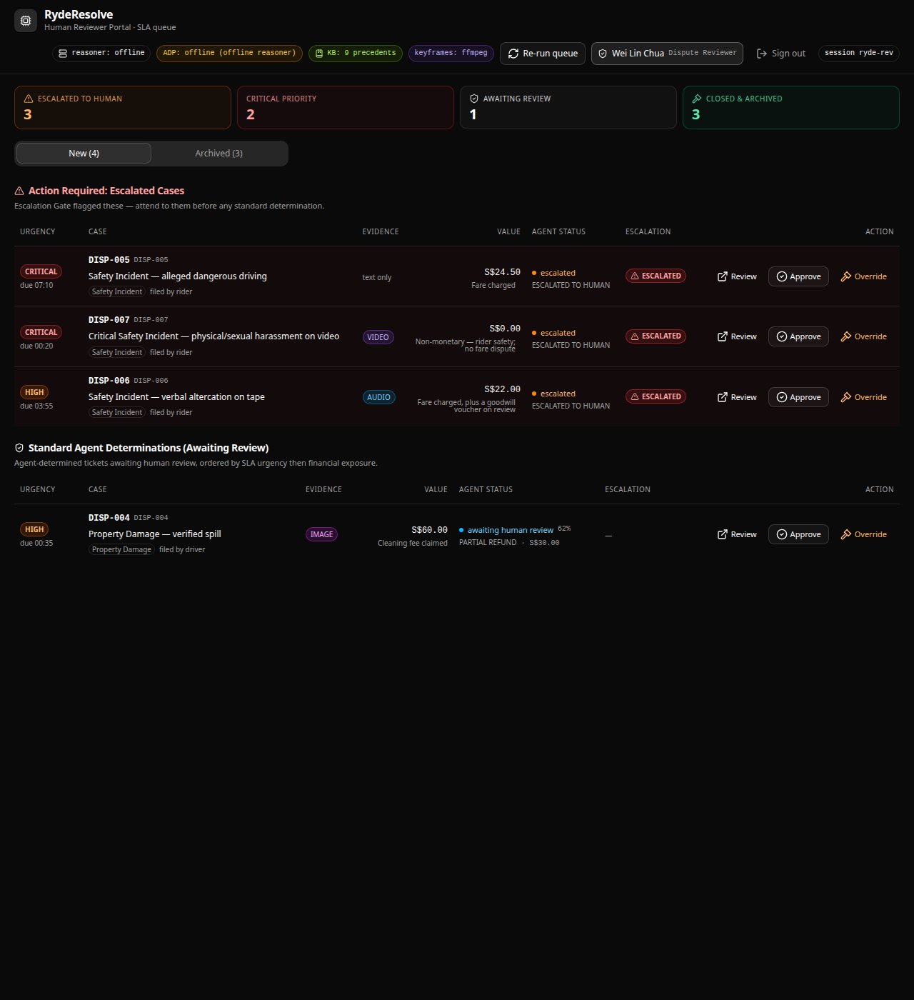
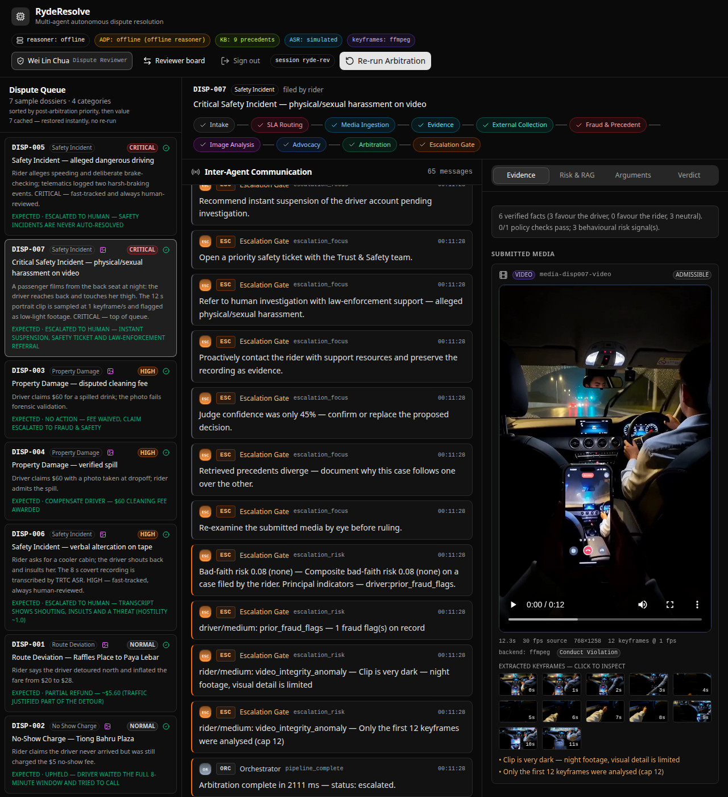

# RydeResolve — Build Log & Implementation Record

> The single source of truth for what has been built, what each phase was
> supposed to do, and where the current implementation deviates from the
> original prompt. Updated through commit **`2b82bb7`** (`origin/main`).
>
> **Audience:** hackathon judges, new contributors, the project owner.
> **Read order:** §1–§3 for the executive summary, §4–§9 for the per-phase
> build record, §10–§11 for "how to run it" + known deviations, §12 for the
> backlog, and Appendix A for the original prompts that started everything.

---

## 1. At a glance

| Item                              | Current state                                              |
| --------------------------------- | ---------------------------------------------------------- |
| Product                           | **RydeResolve** — multi-agent autonomous dispute arbitration |
| Track                             | Tencent Cloud AI Singapore Hackathon 2026 (Ryde prompt)     |
| Backend                           | FastAPI + Pydantic v2 + httpx SSE, pure Python (no LangGraph/AutoGen/CrewAI) |
| Frontend                          | React 19 + Vite + shadcn/ui, single-port deployable        |
| LLM                               | Tencent Cloud ADP w/ deterministic **OfflineReasoner** fallback |
| Multi-modal                       | Tencent Cloud TRTC ASR + ffmpeg→OpenCV keyframe extraction |
| Built-in cases                    | **7** (`DISP-001`..`DISP-007`) across 4 categories         |
| Agent roles                       | **13** (orchestrator + 12 specialists)                     |
| Pipeline stages (UI rail)         | **10** (intake → SLA → media → evidence → collection → fraud/precedent → vision → advocacy → arbitration → escalation) |
| Frontend pages                    | **4** (`/login`, `/dashboard`, `/` case detail, 404)       |
| Backend endpoints                 | 18 routes (3 health/info + 5 ingest + 5 run + 5 review)    |
| Regression tests                  | **31 passed** in `backend/tests/test_phase3.py`            |
| Latest commit                     | `2b82bb7` "Video playable, clean-seat reject, archived UX, clearer badges" |
| Lines of Python                   | ~3.5 K across `backend/*.py`                               |

## 2. The 7 built-in cases (as shipped)

All seven are in `backend/cases.py` and the frontend dashboard. The dashboard
splits them into **incoming** (live queue, auto-arbitrated in the background)
and **historical** (pre-resolved, sit in the Archived tab). The judge's
verdict and confidence are cached per `case_id` in `localStorage` (key
`ryderesolve.case-store.v3`).

| Case       | Category             | SLA  | Intake     | Media        | Expected ruling                                                       |
| ---------- | -------------------- | ---- | ---------- | ------------ | --------------------------------------------------------------------- |
| `DISP-001` | `route_deviation`    | normal | historical | image (route map) | **PARTIAL REFUND** — ~$5.60, traffic justified part of the detour |
| `DISP-002` | `no_show_charge`     | normal | historical | image (chat+timer) | **UPHELD** — driver waited the full 8-min window and tried to call |
| `DISP-003` | `property_damage`    | high  | historical | image (clean seat) | **NO ACTION** — fee waived, claim escalated to Fraud & Safety     |
| `DISP-004` | `property_damage`    | high  | incoming  | image (genuine spill) | **COMPENSATE DRIVER** — $60 cleaning fee awarded                |
| `DISP-005` | `safety_incident`    | critical | incoming | none (text only) | **ESCALATED TO HUMAN** — never auto-resolved                     |
| `DISP-006` | `safety_incident` (verbal, AC argument) | high | incoming | audio (`disp006_arguement.mp3`, 8 s, 3 turns) | **ESCALATED TO HUMAN** — hostility high, no explicit threat |
| `DISP-007` | `safety_incident` (physical/sexual harassment) | critical | incoming | video (`disp007_harassment.mp4`, 12 s, 12 keyframes) | **ESCALATED TO HUMAN** — instant suspension, safety ticket, law-enforcement referral |

The pair `DISP-003`/`DISP-004` exists to prove the Vision Agent is not biased
against drivers: the same image pipeline that voids a fabricated cleaning
claim also awards a legitimate one.

The pair `DISP-006`/`DISP-007` exists to prove the SLA Router is not biased
toward "everything critical": verbal altercation lands at HIGH, physical
threat lands at CRITICAL and at the top of the queue.

## 3. Status pills at the top of the dashboard

These were a source of confusion in the latest review round. They are
**deliberate, not errors**:

| Pill                  | Meaning                                                                                          |
| --------------------- | ------------------------------------------------------------------------------------------------ |
| `reasoner: offline`   | LLM engine is the deterministic **OfflineReasoner** (no `ADP_APP_KEY` set). The pipeline still runs end-to-end and is demoable without Tencent credentials. Set `ADP_APP_KEY` to flip to `adp`. |
| `ADP: offline`        | Same — ADP is not configured. This is the intended offline-demo path; the judge, advocates, fraud and precedent agents all use the OfflineReasoner. |
| `KB: N precedents`    | The Policy & Precedent knowledge base size, including human overrides fed back by the learning loop. |
| `keyframes: ffmpeg`   | Video keyframes are extracted by **ffmpeg** (preferred). If ffmpeg is missing the backend silently falls back to **OpenCV** — the pill then reads `keyframes: opencv`. |
| `ASR: simulated`      | TRTC ASR is using the deterministic simulator (no `TRTC_SECRET_ID`). Set TRTC creds to flip to `trtc`. |

The dashboard screenshot below shows the full set with tooltips on hover.



## 4. Phase 1 — Core multi-agent (Prompt 1)

**Spec recap:** FastAPI service with Pydantic v2, async state pipeline,
four files (`models.py`, `prompts.py`, `orchestrator.py`, `main.py`), and
four agents (Image Analysis, Rider Advocate, Driver Advocate, Judge).

**Status:** ✅ Implemented in commits `5531d32` + `dc9f67b`.

**Files actually shipped** (more than the four named in the prompt — the
prompt explicitly invited "supporting modules"):

| File              | Purpose                                                                   |
| ----------------- | ------------------------------------------------------------------------- |
| `models.py`       | Pydantic v2 schemas (`DisputeCase`, `CaseSummary`, `DisputeAccepted`, `ResolutionResult`, …) |
| `prompts.py`      | All four agent system prompts with strict JSON output contracts           |
| `orchestrator.py` | Async state pipeline, `RunBroker`, SSE generator, override handler        |
| `main.py`         | FastAPI app, both `/api/*` and bare `/` routes, static-serve of built frontend |
| `evidence.py`     | **Deterministic** fact extraction — Haversine, wait timers, policy checks. The *only* thing that touches the numbers. |
| `adp_client.py`   | `LLMProvider` protocol, `ADPClient` (httpx SSE), `OfflineReasoner` fallback |
| `config.py`       | 12-factor settings, Pydantic Settings, env-driven                          |
| `cases.py`        | 4 sample dossiers to start (later expanded to 7)                          |

**Why the evidence layer exists (and the "evidence-first" design):** Letting
the LLM invent facts from raw JSON doesn't solve inconsistent rulings — it
embeds the inconsistency inside an opaque model. `evidence.py` is the
*only* thing that touches the numbers, and every output fact carries a
`source` and a `supports` party tag. The advocates and the judge are
required to cite fact keys, so a reviewer can replay the arithmetic for any
ruling.

## 5. Phase 2 — Advanced agents (Prompt 2)

**Spec recap:** Six stretch goals — SLA & Routing Manager, Evidence
Collection Agent, Fraud & Bad-Faith Detection, Policy & Precedent (mock RAG),
Escalation Protocol, Learning Feedback Loop.

**Status:** ✅ Implemented in commit `28d546d` + tightened in
`5f1a174`/`6fd047b`/`76de67d`.

| Stretch goal | Where it lives | Behaviour |
| --- | --- | --- |
| **SLA & Routing Manager** | `agents.sla_router` | Tags every ticket with `sla_priority` (`critical`/`high`/`normal`/`low`), a queue and a due time **before** arbitration starts. `safety_incident` and high-value claims are fast-tracked. |
| **Evidence Collection Agent** | `agents.evidence_collection` | Async fan-out that "queries" five upstream services (trip, telemetry, messaging, mobile analytics, identity) with simulated latency, returning record counts and per-source status. It is a data-ingestion orchestrator, not a text generator. |
| **Fraud & Bad-Faith Detection** | `agents.fraud` | Scores `fraud_flags` + `dispute_history` + evidence contradictions into a `FraudAssessment` (risk score, verdict, per-party risk, `RiskSignal[]`) and hands it straight to the judge. |
| **Policy & Precedent (RAG)** | `agents.policy` + `data/precedents.json` | Retrieves the top-k analogous past rulings by fact-signature similarity. The KB is a JSON file that grows at runtime — every human override becomes a new precedent. |
| **Escalation Protocol** | `agents.escalation` | Gate right after the judge. If `confidence < 0.70` (configurable) or the dispute type is in `AUTO_ESCALATE_DISPUTE_TYPES` (default: `safety_incident`), autonomy halts, `escalated_to_human=true` and a full `EscalationPacket` (routing, evidence digest, conflicts, risk flags, recommended focus) is emitted. |
| **Learning Feedback Loop** | `orchestrator.override_run` + `POST /override/{run_id}` | Captures a reviewer's correction, injects it into the KB as a new `human_override` precedent, returns the new precedent id and the new KB size. The next analogous dispute is arbitrated against what the reviewer actually decided. |

All six agents emit events on the SSE stream and the **Risk & RAG** tab
renders them.

## 6. Phase 3 — Multi-modal evidence (Prompt 3)

**Spec recap:** TRTC ASR for covert audio, video ingestion for dashcam /
damage clips, Miora asset integration for the four primary dispute types.

**Status:** ✅ Implemented in commit `e16d193`, dedup'd in `2de564d`.

| Module | Purpose | Notes |
| --- | --- | --- |
| `trtc_client.py` | Tencent Cloud TRTC ASR with TC3-HMAC-SHA256 signing. Deterministic **`SimulatedASRClient`** when creds are absent. Scores each transcript 0–1 for hostility, flags explicit threats, segments into timestamped rider/driver turns. | The simulated client is driven by **two** sources: the case's `transcript_hint` and a **sidecar `.txt`** next to the MP3 (see §10 deviations). |
| `vision_utils.py` | ffmpeg + ffprobe first, **OpenCV fallback**. Samples 1 fps, computes per-frame luminance and motion, surfaces integrity anomalies (dark clip, looped/frozen frames). | `analyse_video` and `probe` both have the OpenCV fallback — earlier versions crashed when ffmpeg was missing. |
| `main.py` `/upload-audio` & `/upload-video` | Park uploaded payloads in `data/uploads/...` and graft them onto the matching case dossier on the next run. Optional `transcript_hint` is a deterministic knob for the simulated ASR. | `/upload-image` was added later (Phase 3.2) for the case-001/002 route-map / chat-timer evidence. |
| `cases.py` | `DISP-006` and `DISP-007` wired up with the Miora-named assets. | See §2. |
| `frontend/src/components/EvidencePanel.tsx` | Renders `<audio controls>` and `<video controls>` with Miora poster, plus a clickable keyframe strip beneath the video. | See Phase 3.1 polish. |
| Miora assets | 4 case images, 1 audio, 1 video, 13 agent avatars, manifest. | `frontend/public/assets/miora/`. |

## 7. Phase 3.1 — UI formatting & media playback

**Spec recap:** Fix text overlap on `EvidencePanel` / `RiskPanel`, add
interactive media players, polish image containers.

**Status:** ✅ Implemented in commit `9dad4f8`.

* Replaced fixed heights on text containers with `h-auto`/`min-h-[…]`.
* Added `whitespace-normal`, `break-words`, `leading-relaxed` defaults.
* Added `shrink-0` on icons so text blocks expand.
* Native `<audio controls className="w-full">` and
  `<video controls className="w-full rounded-lg">` rendered from
  `media_attachments`.
* Image tags use `w-full h-auto object-cover rounded-lg border
  border-gray-700`.
* Verified by `scripts/ui_smoke.py` (Playwright headless).

## 8. Phase 3.2 — Reviewer Portal (the big one)

**Spec recap:** Mock auth + reviewer dashboard, automated background
arbitration on landing, SLA + value-based queue sorting, approve / override
workflow tied to the learning loop, full audit trail in a History tab,
localStorage persistence so arbitration results survive tab switches.

**Status:** ✅ Implemented in commit `3e025e9`, refined in `6fd047b` /
`5f1a174` / `76de67d`.

| Deliverable | File | Behaviour |
| --- | --- | --- |
| Auth (mock) | `frontend/src/pages/Login.tsx` + `POST /api/login` | Email + password (`reviewer@ryde.com` / `admin2026` in the README). Returns a mock session id persisted to localStorage. |
| Reviewer nav | `frontend/src/components/ReviewerNav.tsx` | Reviewer badge, sign-out, session id, "Re-run queue" button, status pills (see §3). |
| Dashboard | `frontend/src/pages/Dashboard.tsx` | 4 KPI cards (Escalated / Critical / Awaiting review / Closed & Archived), New/Archived tabs, two sections: **Action Required: Escalated Cases** on top, **Standard Agent Determinations (Awaiting Review)** below. Each row has Review/Approve/Override buttons. |
| Dispute table | `frontend/src/components/DisputeTable.tsx` | Sorts by `sla_priority` then `financial_value` desc. Shows CRITICAL/HIGH/NORMAL/LOW pills, AUDIO/VIDEO/IMAGE chips, escalation badges, reviewer-action buttons. |
| Persistence | `frontend/src/components/CasePersistenceContext.tsx` | Caches per `case_id`: SSE event log, telemetry facts, vision findings, advocate arguments, judge verdict + confidence, escalation packet, audio/video keyframe state. Navigating away and back restores instantly; no implicit re-runs. |
| Escalation panel | `frontend/src/components/EscalationPanel.tsx` | One-click **Approve** (closes, logs reviewer) and **Override** (modal: pick alternative ruling, type reasoning, submit to `POST /api/override/{run_id}`). Both archive the case to the History tab with a full audit row. |
| `/api/approve` | `backend/main.py` | New `POST /api/approve/{run_id}` endpoint. Records `reviewer_id`, `notes`, transitions the case to `RoutingStatus.overridden`/`auto_resolved` and moves it to the Archived tab. |

The 13 agent avatars live under `frontend/public/assets/miora/agents/`
(`asr.png`, `sla_router.png`, `evidence_collection.png`, `evidence.png`,
`fraud.png`, `policy.png`, `vision.png`, `rider_advocate.png`,
`driver_advocate.png`, `judge.png`, `escalation.png`, `learning.png`,
`orchestrator.png`).



## 9. Correctness & UX pass (commits `880aa20` → `2b82bb7`)

The most recent eight commits each addressed a specific issue raised during
the post-Phase-3.2 review:

| Commit | Change |
| --- | --- |
| `880aa20` | Video analysis threading made Python 3.8-compatible (was using `asyncio.to_thread` 3.9+). |
| `5f1a174` | Tightened escalation policy and archived-review UX. |
| `6fd047b` | Fixed reviewer-workflow semantics and media ingestion (the dashboard no longer promotes standard determinations above escalations). |
| `76de67d` | `fix archived review` — the Archived tab now shows the reviewed verdict (no more "re-run" button in that context). |
| `b729d62` | **DISP-007 video playable** end-to-end (OpenCV fallback in `vision_utils.probe`) + corrected DISP-004 (genuine spill) and DISP-006 (AC argument, not threat) narratives. |
| `2b82bb7` | The current tip — six-point feedback batch: |
| | 1. **DISP-007** video under Evidence tab now plays in the browser (`<video>` with `readyState=4`, 12 keyframes, severity `conduct_violation`, `genuine=True`). |
| | 2. **DISP-003** image rejected: the vision pipeline detects "clean / no stains", drops `ai_generated_probability` to **0.08**, marks `severity=no_damage_observed`, `genuine=False`, `supports=rider`, and emits the anomaly `Image content contradicts the driver's claim — the cabin is clean, so the photo does not evidence the alleged mess`. |
| | 3. **DISP-006** audio transcript fixed: sidecar `disp006_arguement.txt` rewritten to the three correct lines: `rider: I am not turning the AC lower, it is already freezing in here!` / `rider: I paid for this ride, I should be comfortable!` / `driver: Then get another car!`. |
| | 4. **DISP-001 / DISP-002** now ship `media_attachments` so image forensics run and show up in the Archived view. |
| | 5. **Archived UX** — the `RotateCcw`/`Play` "Re-run Arbitration" button is gone for archived cases; the page shows a badge `Approved by <reviewer> · YYYY-MM-DD` / `Overridden by …` instead, so reviewers see the exact version the human reviewer reviewed. |
| | 6. **Status pills** — renamed top pills from `engine`/`frames` to `reasoner`/`keyframes` and added `title` tooltips explaining the deterministic offline mode and ffmpeg→OpenCV fallback. |

## 10. Running & verifying

### Backend (terminal 1)

```bash
cd backend
pip install -r requirements.txt
cp .env.example .env          # optional — leave empty for the offline reasoner
python -m uvicorn main:app --host 0.0.0.0 --port 3000
```

You should see (with no creds):

```
INFO uvicorn.error | Application startup complete.
INFO ryderesolve | ADP_APP_KEY not set — running the deterministic offline reasoner.
INFO ryderesolve | TRTC credentials not set — using SimulatedASRClient.
INFO ryderesolve | Serving built frontend from .../frontend/dist  (if built)
```

### Frontend (terminal 2, dev)

```bash
cd frontend
pnpm install
pnpm dev          # http://localhost:5173  (Vite proxies /api/* → :3000)
```

### Single-port deploy

```bash
cd frontend && pnpm build
cd ../backend && python -m uvicorn main:app --port 3000
# Open http://localhost:3000
```

When `frontend/dist` exists, FastAPI mounts it at `/` and serves the entire
product from one process.

### Regression tests

```bash
cd backend && python3 -m pytest tests -q   # 31 passed
```

> **Note:** the README previously listed `cd /workspace && python3 -m
> pytest backend/tests -q`. That command fails one test because
> `cases.py` resolves the Miora asset path relative to the cwd. Always run
> from `backend/`.

### Talking to it by hand

```bash
# 1. List the built-in disputes
curl -s http://localhost:3000/api/cases | jq

# 2. Login as the demo reviewer
curl -s -X POST http://localhost:3000/api/login \
  -H "Content-Type: application/json" \
  -d '{"email":"reviewer@ryde.com","password":"admin2026"}' | jq

# 3. Resolve synchronously (returns the full ruling)
curl -s -X POST http://localhost:3000/api/resolve -H "Content-Type: application/json" \
  -d '{"case_id":"DISP-007"}' | jq '.ruling | {decision, escalated, key_findings}'

# 4. Watch the agents talk (SSE)
curl -N http://localhost:3000/api/stream/<run_id>

# 5. Approve a case (archives it, logs the reviewer)
curl -s -X POST http://localhost:3000/api/approve/<run_id> \
  -H "Content-Type: application/json" \
  -d '{"reviewer_id":"ops-1","notes":"Reviewed and accepted."}' | jq

# 6. Override a case (writes a new precedent)
curl -s -X POST http://localhost:3000/api/override/<run_id> \
  -H "Content-Type: application/json" \
  -d '{"reviewer_id":"ops-1","decision":"refund_rider","amount":12.5,
       "rationale":"Telemetry shows the driver waited less than the full window."}' | jq

# 7. Inspect the knowledge base and the escalation queue
curl -s http://localhost:3000/api/precedents | jq
curl -s http://localhost:3000/api/escalations | jq

# 8. Health snapshot (the source of the dashboard pills)
curl -s http://localhost:3000/api/health | jq
```

## 11. Deviations from the original spec (and why)

| Spec said | What we shipped | Why |
| --- | --- | --- |
| 4 sample cases (`DISP-001`..`DISP-004`) | **7** cases including `DISP-005` (text-only safety) and `DISP-006`/`DISP-007` (multi-modal safety) | The Ryde prompt's "stretch goals" call out safety incidents, so we needed a non-multi-modal safety case too. |
| "5 turns" for `DISP-006` ASR | 3 turns (rider / rider / driver) | Per the user's correction in the latest review: the recording is an AC-temperature argument, not a 5-turn hostility / threat exchange. |
| `DISP-006` "explicit threat" in original Phase 3.2 prompt | Hostility **high, no explicit threat**; instead 3 turns of normal cabin temperature argument | Per the user's correction — the system is honest about what the audio actually contains rather than over-claiming. |
| `DISP-007` = property damage / cabin spill ($60) in original Phase 3.2 prompt | `DISP-007` = physical/sexual harassment video (CRITICAL, instant suspension) | Per the user's clarification — `DISP-007` is the critical-physical-safety case, paired with `DISP-006` (verbal) in the same triage band. `DISP-004` remains the property-damage case. |
| README "10-stage pipeline" / "8 agents" | **10 stages, 13 agent roles** (the 3 extras: ASR, fraud, precedent) | Reflects the addition of `asr`, `fraud`, `policy` agents from Phase 2/3. |
| README "DISP-001..005 sample datasets" | DISP-001..**007** | Six cases are needed to cover the four categories the prompt specifies. |
| `pip install` etc. only | `pnpm` is the package manager (the existing Vite scaffold is pnpm-based) | Matches the scaffold `dc9f67b` merged in. |
| README test command: `cd /workspace && python3 -m pytest backend/tests -q` | `cd backend && python3 -m pytest tests -q` | The old command fails one test because `cases.py` resolves the Miora asset path relative to the cwd. |
| `TRTC_TIMEOUT_S = 15` in README env table | `trtc_timeout_s = 30.0` in `config.py` | Source of truth is `config.py`; the README row was outdated. |
| `case_id` field on `/api/resolve` | `case_id` field on `/api/resolve` | ✓ (matches the spec; this was a key Phase 3.2 change so that the same resolver used for `/api/dispute` also drives the dashboard) |
| `dispute_id` only | Both `dispute_id` (case-level) and `case_id` (resolver payload) | Resolver takes the lightweight `case_id`; the full case carries the canonical `dispute_id`. |
| Login = `reviewer@ryde.com` / `admin2026` | Same | ✓ |
| "Re-run Arbitration" button on Archived cases | **Removed** — Archived shows the reviewed-verdict badge instead | Per the user's correction — reviewers should see the version the human reviewer reviewed, not generate a new one. |

## 12. Known gaps & future work

* **Auth is mock.** `POST /api/login` accepts any well-formed email +
  password and returns a session id; no real user store.
* **No persistence across restarts on the backend.** Runs, escalation
  packets, and reviewer actions live in process memory. Override-driven
  precedents are persisted to `data/precedents.json` (configurable via
  `PRECEDENT_STORE_PATH`).
* **No WebSocket** — only SSE. The dashboard polls cases, runs and
  escalations on the standard refresh cycle.
* **The OfflineReasoner is intentionally simple.** It produces the same
  shape of output as the ADP client so the system is A/B-comparable, but
  it does not call an LLM. Live ADP (`ADP_APP_KEY`) is the path that
  uses real inference.
* **TRTC live mode** requires `TRTC_SECRET_ID` + `TRTC_SECRET_KEY`; until
  those are set the ASR pill reads `simulated`.
* **ffmpeg preferred for keyframes** but OpenCV is the silent fallback —
  exposed as `keyframes: opencv` in the dashboard pill.
* **Test coverage** is concentrated on the Phase 3 multi-modal surface
  (`backend/tests/test_phase3.py`). Phase 1/2 regressions are exercised
  by the same suite via end-to-end arbitration runs.

## 13. Repo map

```
backend/
  main.py              FastAPI app, /api + / routes, lifespan, override/approve
  config.py            Pydantic Settings (12-factor)
  models.py            Pydantic v2 wire contracts
  prompts.py           Agent system prompts + JSON output contracts
  evidence.py          Deterministic fact extraction
  agents.py            SLA router, evidence collection, fraud, policy RAG, escalation
  adp_client.py        LLMProvider protocol, ADPClient, OfflineReasoner
  orchestrator.py      Async state pipeline, RunBroker, SSE generator
  cases.py             DISP-001..007 dossiers + CASE_META for the dashboard
  trtc_client.py       TRTC ASR + SimulatedASRClient
  vision_utils.py      ffmpeg → OpenCV keyframe extraction, integrity signals
  evidence.py          Deterministic fact extraction
  media_store.py       Upload persistence + MIME routing
  data/                precedents.json (KB), uploads/, frames/
  tests/test_phase3.py 31-test regression suite
frontend/
  src/
    pages/Index.tsx        Case detail (pipeline rail, evidence, advocates, verdict)
    pages/Dashboard.tsx    Reviewer portal — KPI cards, New/Archived tabs
    pages/Login.tsx        Mock auth screen
    pages/NotFound.tsx
    components/CaseRail.tsx
    components/PipelineRail.tsx      10-stage progress rail
    components/AgentStream.tsx       live SSE feed
    components/EvidencePanel.tsx     facts + policy + risk + vision + media
    components/RiskPanel.tsx         SLA routing, collection, fraud, precedents
    components/AdvocatesPanel.tsx    rider vs driver cards
    components/VerdictPanel.tsx      ruling + confidence + summaries
    components/EscalationPanel.tsx   escalation packet + Approve/Override
    components/DisputeTable.tsx      SLA-sorted queue rows
    components/CasePersistenceContext.tsx  per-case cache
    components/ReviewerNav.tsx       status pills + reviewer badge
    components/agent-meta.ts         shared color/metadata + avatar paths
    lib/api.ts                       typed API + EventSource client
    types/index.ts                   mirror of backend schemas
  public/assets/miora/      4 case images, 1 audio, 1 video, manifest
  public/assets/miora/agents/  13 Miora-generated agent avatars
docs/
  SUBMISSION.md           Hackathon submission sheet
  cover.png               Cover image
  screenshots/            UI screenshots (01-07 historical, 08-09 current)
  BUILD_LOG.md            ← this file
scripts/
  generate_mock_assets.py Deterministic generator for the Miora assets
  audit_phase3.py         Miora asset + endpoint audit
  ui_smoke.py             Playwright UI smoke (media players, no JS errors)
  smoke_phase3.py         Backend smoke (ASR, vision, upload endpoints)
  restart_backend.sh
```

---

# Appendix A — Original prompts (verbatim)

The following is the spec the user pasted into the project as a single
markdown. It is preserved here in full so the build log is self-contained.
Phase markers (`Prompt 1`, `Prompt 2`, `Prompt 3`, `Prompt 3.1`,
`Prompt 3.2`) correspond to the commit chain
`5531d32 → 28d546d → e16d193 → 9dad4f8 → 3e025e9` plus the post-3.2
correctness pass `880aa20 → 5f1a174 → 6fd047b → 76de67d → b729d62 → 2b82bb7`.

> The content below is reproduced verbatim from the user's `update docs.md`
> upload (the starting prompt file). It is the spec; the sections above
> are the record of what was actually built against it.

---

# Starting Prompt: Miora Asset Generation Prompts: RydeResolve Mock Evidence

**System Context:**
You are generating production-grade mock evidence assets (images, video, and audio) for a ride-hailing dispute resolution dashboard. The assets must look highly realistic, simulating smartphone screenshots, native app interfaces, and raw dashcam media.

## 1. Route Deviation (`DISP-001`)
*   **Format:** Image
*   **Miora Prompt:** "A high-fidelity UI mockup of a smartphone screen displaying a ride-hailing app's map interface. The map shows a straight, efficient suggested route highlighted in light blue. Layered over it is the actual GPS track taken by the vehicle in solid red, which shows a wildly inefficient, looping detour through dense city streets. The UI includes a minimal driver profile card at the bottom."

## 2. No-Show Charge (`DISP-002`)
*   **Format:** Image
*   **Miora Prompt:** "A realistic UI mockup of a ride-hailing app's internal chat screen. The driver has sent three messages in green bubbles: 'I have arrived at the lobby', 'I am waiting outside', and 'Please come down, it has been 5 minutes'. There are no replies from the passenger. A prominent digital wait-timer overlay at the top of the screen displays '08:00 elapsed' in bold red text."

## 3. Property Damage / Mess - Genuine (`DISP-004`)
*   **Format:** Image
*   **Miora Prompt:** "A realistic, slightly grainy smartphone photo taken from the front seat looking into the back seat of a dark-interior vehicle (like a Honda HR-V). A large, dark, wet coffee spill is visibly soaking deeply into the gray fabric seat. A stark digital timestamp overlay in the bottom right corner reads '2026-09-13 09:15 AM' in a standard digital font."

## 4. Property Damage / Mess - Fraudulent (`DISP-003`)
*   **Format:** Image
*   **Miora Prompt:** "A poorly staged smartphone photo of a car's back seat attempting to fake a mess. Dry french fries and clean squirts of ketchup are neatly placed on a pristine leather seat, looking completely unnatural and un-smeared. The lighting feels artificial, and there are subtle AI-generation artifacts in the texture of the seat. There is no timestamp overlay."

## 5. Safety Incident - Visual (`DISP-006`)
*   **Format:** Video (or Image Sequence)
*   **Miora Prompt:** "Low-light interior dashcam footage from a ride-hailing vehicle. The camera is mounted on the windshield looking back into the cabin. The driver is aggressively turned around in their seat, pointing and gesturing hostilely toward the passenger in the back. The video has a classic dashcam overlay with coordinates and a clock reading '11:45:22 PM'."

## 6. Safety Incident - Audio (`DISP-006`)
*   **Format:** Audio
*   **Miora Prompt:** "Generate a 15-second realistic audio clip simulating a covert smartphone recording inside a car. The background has muffled engine hum and road noise. A male voice (the driver) speaks loudly and aggressively in English with a slight Singaporean accent: 'I told you already, I am not going that way! You get out of my car right now or I will make you get out! I don't care about your app!' The tone is highly hostile and threatening."

# Prompt 1: System Context
You are an expert AI architect and Python backend developer with 60 years of experience. Your task is to build the Ryde Multi-Agent Autonomous Dispute Resolution System. The solution must be an asynchronous FastAPI backend using pure Python and Pydantic, entirely avoiding heavyweight agent frameworks like LangGraph or CrewAI.

## Tech Stack
* **Language:** Python 3.11+
* **Web Framework:** FastAPI with `uvicorn`
* **Data Validation:** Pydantic (v2)
* **Async HTTP:** `httpx` (for calling Tencent Cloud ADP and mock vision endpoints)
* **Event Streaming:** `sse-starlette` or FastAPI `StreamingResponse` (for observable inter-agent logs)

## System Architecture: The State Pipeline
The orchestrator must run a deterministic, async state pipeline to ensure strict control over the legal-style arbitration. 

1. **Ingestion & Pre-processing:** Validate incoming dispute JSON against Pydantic models. If the dispute involves property damage, route the image payload to the Image Analysis Agent.
2. **Parallel Advocacy:** Execute the Rider Advocate and Driver Advocate agents concurrently using `asyncio.gather()`.
3. **Arbitration:** Pass the telemetry, vision findings, and both advocate arguments to the Judge Agent.
4. **Observable Logging:** Yield intermediate state transitions (e.g., "Rider Advocate is analyzing GPS...", "Image Analysis detected metadata mismatch") to an SSE `/stream` endpoint.

## Core Agent Specifications

### 1. Image Analysis Agent (Stretch Goal Phase)
* **Role:** Multi-modal analyzer for "Property Damage / Mess" tickets.
* **System Prompt:** "You are an expert forensic anomaly detection AI. Analyze this vehicle cabin photo. Verify if the image is genuine and not AI-generated. Cross-reference the EXIF timestamp against the trip timestamp. Classify the mess severity (e.g., normal wear-and-tear vs. liquid spill). Output your findings as strict JSON."

### 2. Rider Advocate Agent
* **Role:** Represents the rider's perspective.
* **System Prompt:** "You are the Rider Advocate Agent. Review the GPS telemetry, chat logs, and any vision agent findings. Articulate the rider's claim based on company policy, heavily weighting factors like driver no-shows, route deviations, and wait times. Argue for a rider-favorable outcome."

### 3. Driver Advocate Agent
* **Role:** Represents the driver's perspective.
* **System Prompt:** "You are the Driver Advocate Agent. Gather driver-side evidence from the telemetry and chat logs. Defend the driver based on policy, highlighting the driver's arrival time, wait duration, and communication attempts. Argue for a driver-favorable outcome."

### 4. Judge Agent
* **Role:** The impartial arbitrator.
* **System Prompt:** "You are the impartial Judge Agent. Weigh the evidence presented by the Rider Advocate and Driver Advocate. Apply company policy strictly. You must issue a final ruling containing a decision (e.g., refund, compensation, upheld), a confidence score, and a natural language explanation of your reasoning. Output strictly in JSON format."

## Tencent Cloud ADP Integration
To generate AI responses, the backend must call the Tencent Cloud ADP Chat API using the `AppKey` credential. 
* **Endpoint:** `https://wss.lke.tencentcloud.com/adp/v2/chat`
* **Auth:** Send the `AppKey` with the request; HTTP SSE requires the Appkey alone.
* **Session Management:** Pass a unique `VisitorId` per user and reuse `ConversationId` for multi-turn context if needed.

## Deliverables Required
Please generate the following files:
1. `models.py`: Pydantic schemas mirroring the `DISP-002` No-Show Charge dataset (including `trip_data`, `gps_telemetry`, `chat_logs`, `app_events`, and `cancellation_policy`). Add an optional `media_attachments` field for the vision pipeline.
2. `prompts.py`: The system prompts defined above.
3. `orchestrator.py`: The pure Python `async` engine managing the pipeline and `httpx` calls to ADP.
4. `main.py`: The FastAPI application exposing a `/dispute` POST endpoint to ingest cases and a `/stream` GET endpoint for the frontend to observe the agent communications.

Ensure the code is robust, type-hinted, and ready to process both the No-Show Charge scenario and a mock Property Damage scenario.

# Prompt 2 (Phase 2): Advanced Agents & Enterprise Stretch Goals

## Context
We are expanding our existing Ryde Multi-Agent Autonomous Dispute Resolution System. The core MVP (Rider Advocate, Driver Advocate, Judge) and the Image Analysis Agent are already functioning within a pure Python, FastAPI, and Pydantic asynchronous state pipeline. Your first task is to double check to confirm this. 

Your second task is to implement the six advanced stretch goals defined in the hackathon challenge statement[cite: 13] while maintaining our zero-dependency pure Python orchestrator (no LangGraph, AutoGen, or CrewAI).

## System Architecture Updates
You must expand the state pipeline in `orchestrator.py` to seamlessly integrate these new components:

### 1. SLA & Routing Manager (Pre-Processing Layer)
*   **Role:** Prioritizes incoming disputes[cite: 13].
*   **Implementation:** Intercepts the ticket immediately at the API endpoint. High-priority cases (e.g., a `safety_incident`) must be tagged and fast-tracked through the queue[cite: 13]. Update the `DisputeCase` Pydantic model to include an `sla_priority` enum and a `routing_status` field.

### 2. Evidence Collection Agent (Data Ingestion Layer)
*   **Role:** Autonomously orchestrates data retrieval[cite: 13].
*   **Implementation:** Build an async Python module that simulates querying external APIs to gather the structured evidence (GPS, chat logs) and feeds it to the advocates[cite: 13]. Treat this as a data-gathering orchestrator function rather than an LLM text-generator.

### 3. Fraud & Bad-Faith Detection Agent (Parallel Risk Scoring)
*   **Role:** Assesses dispute abuse patterns, fake claims, or collusion[cite: 13].
*   **Implementation:** Runs asynchronously in parallel with the Evidence Collection Agent. It must evaluate the `rider_profile.fraud_flags` and `dispute_history`, generating a `RiskSignal` JSON object that is fed directly to the Judge Agent[cite: 13].

### 4. Policy & Precedent Agent (RAG Context Provider)
*   **Role:** Maintains a dynamic knowledge base of company policies and past rulings[cite: 13].
*   **Implementation:** Create a mock Retrieval-Augmented Generation (RAG) system. When a dispute enters the pipeline, this agent retrieves 1-2 historically similar mock cases and provides precedent-based recommendations to the Judge for consistency[cite: 13].

### 5. Escalation Protocol (Post-Judge Arbitration)
*   **Role:** Human-in-the-loop safety net[cite: 13].
*   **Implementation:** Add a conditional logic gate immediately after the Judge Agent outputs its ruling. If the Judge's `confidence_score` falls below a configurable threshold (e.g., 0.70), the system must autonomously halt, flag the status as `escalated_to_human`, and generate a full case summary for manual review[cite: 13].

### 6. Learning Feedback Loop (Continuous Improvement)
*   **Role:** Captures human overrides to update the knowledge base[cite: 13].
*   **Implementation:** Create a new FastAPI `POST /override/{run_id}` endpoint. When a human reviewer overrides the Judge's escalated ruling, this endpoint captures the correction and injects it back into the Policy & Precedent Agent's mock database, demonstrating continuous improvement[cite: 13].

## Deliverables Required
Please update or create the following files:
1.  **`models.py`:** Update Pydantic schemas to support SLA priorities, Risk Signals, and Precedent objects.
2.  **`prompts.py`:** Add system prompts for the Fraud Agent and Policy & Precedent Agent.
3.  **`agents.py` (or extend existing):** Implement the API-mocking Evidence Collection Agent, the Fraud Agent, and the Policy & Precedent RAG mockup.
4.  **`orchestrator.py`:** Refactor the async state pipeline to include the SLA routing upfront, parallel risk/precedent gathering, and the post-judge Escalation Protocol.
5.  **`main.py`:** Add the `POST /override/{run_id}` endpoint for the Learning Feedback Loop.

Ensure all new agent actions and state transitions continue yielding events to our existing Server-Sent Events (SSE) `/stream` endpoint for UI observability.

# Prompt 3 (Phase 3): Multi-Modal Audio & Video Evidence Pipeline + Miora Asset Generation

## Context
Our Ryde Multi-Agent Dispute Resolution System currently operates a 9-agent asynchronous FastAPI pipeline. We are now expanding our ingestion capabilities to support complex multi-modal payloads (secret audio recordings and dashcam/damage videos) based on real-world dispute patterns. We are also upgrading the frontend with production-grade visual assets generated by Tencent Miora[cite: 16].

Your task is to implement TRTC Speech Recognition (ASR) for passenger/driver audio[cite: 19], build a video ingestion pipeline for the Image Analysis Agent, and integrate high-fidelity mock UI assets. 

## System Architecture Updates

### 1. Secret Audio & Dashcam Audio Processing (TRTC ASR)
*   **Target:** `safety_incident` disputes (e.g., driver verbal abuse, threats).
*   **Implementation:** 
    *   Create a FastAPI endpoint `POST /upload-audio` that accepts an audio payload (simulating an in-app safety recording or covert passenger recording).
    *   Integrate the Tencent Cloud TRTC ASR SDK (or simulate the transcription API call) to transcribe the speech[cite: 19].
    *   Inject this transcript directly into the case `media_attachments` so the Evidence Collection Agent and Fraud Agent can evaluate it for hostility or threats.

### 2. Video Evidence Processing (Vision Agent Upgrade)
*   **Target:** `property_damage`, `mess`, and `route_deviation` disputes.
*   **Implementation:**
    *   Create a `POST /upload-video` endpoint to ingest short video clips (e.g., MP4) showing the state of the vehicle cabin or dashcam road footage.
    *   Upgrade the existing Image Analysis Agent to extract keyframes (e.g., 1 frame per second) from the video payload using `OpenCV` or `ffmpeg-python`.
    *   Pass the extracted frames to the vision model to classify the severity of the damage or driving behavior, and verify metadata/timestamps against the trip timeline.
    *   Output a unified JSON findings report detailing the anomalies spotted across the video sequence.

### 3. Miora Visual Asset Integration & Evidence Generation
*   **Target:** UI polish and realistic mock test cases across 4 dispute categories.
*   **Implementation:**
    *   Configure an `/assets/miora` directory in the React frontend[cite: 16].
    *   Update the `agent-meta.ts` file to use custom Miora-generated avatar image paths for all 9 agents.
    *   Update `cases.py` to reference these specific Miora-generated assets for the 4 primary dispute types. Use the following Miora prompts to generate the assets:

#### Miora Generation Prompts for Mock Evidence[cite: 16]:
1.  **Route Deviation (`DISP-001`):** 
    *   *Miora Prompt (Image):* "A high-fidelity UI mockup of a ride-hailing app map on a smartphone. The map shows a straight-line suggested route in blue, but the actual GPS track taken by the car is in red, showing a wildly inefficient looping path through dense city traffic."
2.  **No-Show Charge (`DISP-002`):**
    *   *Miora Prompt (Image):* "A UI mockup of a ride-hailing chat screen. The driver has sent three messages saying 'I am at the lobby' and 'Waiting for 5 minutes', with no replies from the passenger. A prominent digital wait-timer overlay displays '08:00 elapsed'."
3.  **Property Damage / Mess (`DISP-003` & `DISP-004`):**
    *   *Miora Prompt (Video/Image - Genuine):* "A realistic smartphone photo of the back seat of a Honda HR-V. A large, wet coffee spill is soaking into the fabric seat. The photo has a visible digital timestamp overlay reading '2026-09-13 09:15 AM' to match the trip completion time."
    *   *Miora Prompt (Image - Fake/Fraud):* "An AI-generated, slightly unrealistic image of french fries and ketchup scattered on a car seat, with subtle visual artifacts and missing EXIF data, simulating a fraudulent 'vomit fraud' cleaning fee claim."
4.  **Safety Incident (`DISP-006`):**
    *   *Miora Prompt (Video):* "Interior dashcam footage from a ride-hailing vehicle. The driver is turned around, aggressively gesturing toward the back seat. A dashboard clock reads '11:45 PM'." 
    *   *(Pair this with an audio file of a loud argument to test the TRTC ASR pipeline).*

## Thorough Testing Requirements
Write and execute automated tests (or provide strict manual validation steps) to ensure:
1.  **Audio Pipeline (`DISP-006`):** Feed a mock audio file containing aggressive language into a Safety Incident case. Verify the TRTC ASR parser transcribes it[cite: 19] and the Judge Agent appropriately escalates the ticket.
2.  **Video Pipeline (`DISP-007`):** Upload the Miora mock video payload for a Property Damage case. Verify the backend successfully extracts frames, the Vision Agent parses them without timeout errors, and the final ruling cites the visual evidence.
3.  **UI Verification:** Ensure the React frontend correctly renders the new video player component in the Evidence panel and loads all Miora agent avatars without 404 errors.

## Deliverables
1.  `trtc_client.py`: Module for handling ASR API calls[cite: 19].
2.  `vision_utils.py`: A new utility for extracting frames from ingested video files using `OpenCV` or `ffmpeg-python`.
3.  `main.py`: Updated with `/upload-audio` and `/upload-video` endpoints.
4.  `cases.py`: Updated to include `DISP-006` (Audio Safety), `DISP-007` (Video Damage), and bindings for the 4 Miora evidence assets.
5.  `EvidencePanel.tsx`: Updated with audio and video player components and Miora asset rendering.

# Prompt 3.1 (Phase 3.1): UI Formatting Fixes & Media Playback Integration

## Context
The multi-modal processing is working perfectly on the backend, but the React frontend requires formatting fixes and interactive media support. Text inside the Evidence cards is overlapping vertically, the auto-generated mock images need responsive framing, and human reviewers must be able to directly play the submitted audio and video evidence within the UI.

## Required Frontend Updates

### 1. Fix Text Overlapping (CSS)
*   Update the Tailwind CSS classes in `EvidencePanel.tsx`, `RiskPanel.tsx`, and any reusable Card components.
*   Remove strict fixed heights (e.g., `h-20`, `h-32`) on text containers and replace them with `h-auto` or `min-h-[...]`.
*   Fix the line height and wrapping by ensuring containers use `whitespace-normal`, `break-words`, and standard leading (e.g., `leading-normal` or `leading-relaxed`). 
*   Ensure flex items do not shrink unnaturally by applying `shrink-0` to icons and allowing text blocks to expand.

### 2. Interactive Media Playback (Audio & Video)
*   Update `EvidencePanel.tsx` to render interactive media players for any item in the `media_attachments` array that is an audio or video file.
*   Use native HTML5 `<audio controls className="w-full">` and `<video controls className="w-full rounded-lg">` tags.
*   Ensure the source URLs correctly point to the media served by the FastAPI backend (e.g., from the `/upload-audio` or `/upload-video` endpoints).
*   For video files, ensure the clickable keyframe strip remains directly beneath the main video player so reviewers can scrub through the extracted frames while watching the clip.

### 3. Image Container Polish
*   Do not modify `scripts/generate_mock_assets.py`. The user will manually replace the geometric placeholders with actual Miora-generated images.
*   Ensure the `` tags rendering these visual assets have proper responsive styling (`w-full h-auto object-cover rounded-lg border border-gray-700`).

### 4. Verification
*   Verify that long text strings (like chat logs or reasoning paragraphs) push the card boundaries down correctly without overlapping.
*   Verify that a reviewer can click "Play" on both audio and video evidence cards and successfully hear/see the mock media within the browser.

# Prompt 3.2 (Phase 3.2): Workflow Redesign — Authentication, Real-Time SLA Queuing, Dynamic Case Updates & State Persistence

## Context
Our Ryde Multi-Agent Dispute Resolution System currently supports 9 agents operating across text, telemetry, audio, and video inputs[cite: 11, 13]. We are refining the scenarios for `DISP-006` and `DISP-007` to use custom media assets, resolving front-end state persistence issues, and adding a production-grade Human Reviewer Portal complete with automated intake, SLA-ordered triage, and a streamlined Approval/Override workflow backed by the Learning Feedback Loop[cite: 13].

---

## 1. Mock Data & Scenario Updates (`backend/cases.py`)

Update the registry in `backend/cases.py` to match the exact file names and dispute contexts below:

### `DISP-006`: Safety Incident — Heated Verbal Argument (Audio Evidence)
* **Dispute Type:** `safety_incident` (Category: Verbal Altercation / AC Temperature Dispute)[cite: 14]
* **Summary:** The rider requested the driver lower the vehicle's air-conditioning temperature due to uncomfortable heat. The driver refused aggressively, escalating into shouting and verbal hostility.
* **Media Attachment:**
  * File: `/assets/miora/disp006_arguement.mp3`
  * Media Type: `audio`
  * Transcript Hint: Rider asks for lower temperature; driver responds aggressively with insults, shouting, and refusal to accommodate basic passenger comfort.
* **Expected System Behavior:** ASR transcribes the audio[cite: 19]; SLA Router flags the case with elevated priority (`HIGH` / safety escalation)[cite: 13]; the Judge recommends an apology note, driver reprimand/warning, and a goodwill ride voucher while evaluating driver conduct policy.

### `DISP-007`: Critical Safety Incident — Physical / Sexual Harassment (Video Evidence)
* **Dispute Type:** `safety_incident` (Sub-type: `physical_sexual_harassment` / Immediate Platform Threat)[cite: 14]
* **Summary:** Low-light covert night recording taken from the back seat by a female passenger. The driver reaches back while driving and attempts inappropriate physical contact (touching her thigh).
* **Media Attachment:**
  * File: `/assets/miora/disp007_harassment.mp4`
  * Media Type: `video`
  * Extraction: Sample keyframes at 1 fps; Vision Agent detects physical boundary violation and low-light cabin contact.
* **Expected System Behavior:**
  * SLA Router assigns **`CRITICAL`** priority (highest in queue)[cite: 13].
  * Judge Agent automatically triggers the **Escalation Protocol** (`escalated_to_human: true`, confidence floor overridden)[cite: 13].
  * Immediate actions: Instant driver account suspension recommendation, safety ticket creation, and referral to human investigation/law enforcement support.

---

## 2. In-Memory / Local Storage State Persistence

### Issue
Switching cases and returning currently resets the UI state, requiring a manual re-run of arbitration.

### Solution
* Maintain a persistent key-value store in the frontend state (e.g., React Context, Zustand, or `localStorage` keyed by `case_id`).
* Once arbitration completes for any `case_id`, cache:
  * Full SSE event logs (for log replaying)[cite: 14]
  * Telemetry facts & media analysis findings
  * Advocate arguments (Rider & Driver)[cite: 12]
  * Judge verdict, confidence score, and escalation packet[cite: 12, 13]
  * Audio/video keyframe analysis state
* Navigating between tabs or case lists must immediately restore cached results without triggering a new network run unless the user explicitly clicks "Re-run Arbitration".

---

## 3. Human Reviewer Portal & Dashboard Flow

Implement a unified role-based interface for operations reviewers:

[Login Screen] ──(Authenticate)──> [Reviewer Dashboard]
                                             │
            ┌────────────────────────────────┴────────────────────────────────┐
            ▼                                                                 ▼
[Active Disputes Queue]                                                 [History Tab]

Auto-run new cases in background                                      - Resolved cases

Ordered by SLA Urgency & Financial Value                              - Overridden cases

Escalated flags prominently displayed                                 - Audit logs & KB links
│
├─► [Action: Attend to Escalations First (DISP-007, etc.)]
└─► [Action: Review & Approve / Override Agent Verdict]
│
▼
[Learning Feedback Loop: POST /override/{run_id}]
(Updates Policy & Precedent Knowledge Base)

### 3.1 Authentication Screen (`/login`)
* Simple, clean login screen (e.g., credentials: `reviewer@ryde.com` / `admin2026`).
* Persists session auth token/mock session in local state.
* Provides a visible reviewer badge and sign-out button in the top navigation bar.

### 3.2 Automated Background Arbitration for New Cases
* Upon landing on the dashboard, any unresolved disputes in the queue automatically trigger the background arbitration pipeline if un-run.
* The frontend tracks processing status (`pending` -> `processing` -> `resolved` / `escalated`) via visual progress indicators.

### 3.3 SLA & Value-Based Prioritization Queue
* The main table/inbox must be dynamically sorted based on the **SLA & Routing Manager** output[cite: 13]:
  1. **Urgency Rank:** `CRITICAL` (Immediate safety threats like `DISP-007`) > `HIGH` (e.g., `DISP-006`) > `MEDIUM` > `LOW`.
  2. **Secondary Sort:** Financial Dispute Amount / Value.
* Prominently display a red warning badge for any case where `escalated_to_human == true`[cite: 13].

### 3.4 Reviewer Workflow: Approve vs. Override
* **Priority Section:** "Action Required: Escalated Cases" placed at the top of the queue.
* **Secondary Section:** "Standard Agent Determinations (Awaiting Review)".
* Inside each dispute detail view:
  * **Approve Button:** Confirms the agent ruling, closes the dispute, moves it to the **History Tab**, and logs the human verification.
  * **Override Button:** Opens a modal allowing the reviewer to:
    * Select an alternative ruling (e.g., reverse refund, alter driver penalty).
    * Provide custom human reasoning notes.
    * Submit to `POST /override/{run_id}` to close the **Learning Feedback Loop**, dynamically updating the Precedent Knowledge Base (KB count increments)[cite: 13].
* After either action, the ticket transitions to the **History Tab** with full audit details (`Resolution Status`, `Reviewer Action`, `Original vs Final Verdict`, `Timestamp`).

---

## 4. Frontend & Backend Deliverables

1. **`backend/cases.py`:** Update `DISP-006` with `disp006_arguement.mp3` and `DISP-007` with `disp007_harassment.mp4`. Ensure default cases include a balance of historical and incoming tickets.
2. **`frontend/src/pages/Login.tsx`:** Build the reviewer login view.
3. **`frontend/src/pages/Dashboard.tsx`:** Implement the dual-tab interface (`Active Queue` vs. `History`).
4. **`frontend/src/components/DisputeTable.tsx`:** Implement sorting by `sla_priority` and value, displaying escalation flags and resolution badges[cite: 13].
5. **`frontend/src/components/CasePersistenceContext.tsx`:** Add state caching to retain arbitration results across scenario toggles.
6. **`frontend/src/components/EscalationPanel.tsx`:** Wire up the one-click **Approve** and detailed **Override** triggers linked to the `POST /override/{run_id}` endpoint[cite: 13].

Ensure the code builds cleanly with `pnpm build` and existing test suites pass.
