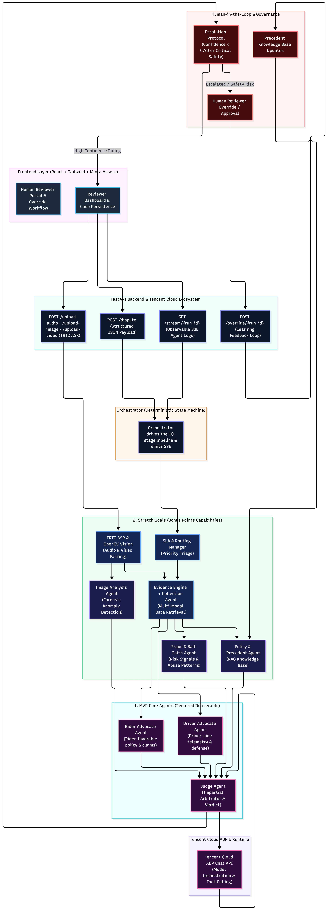
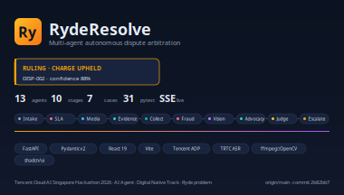
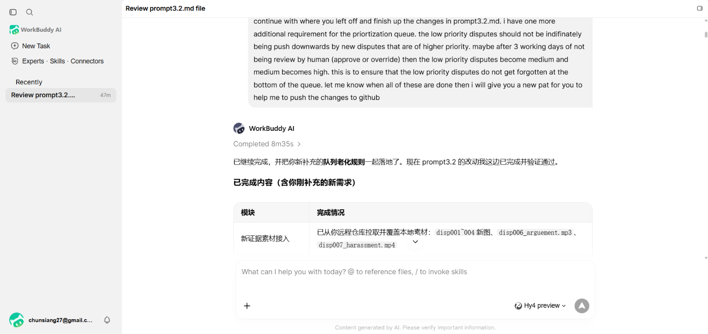
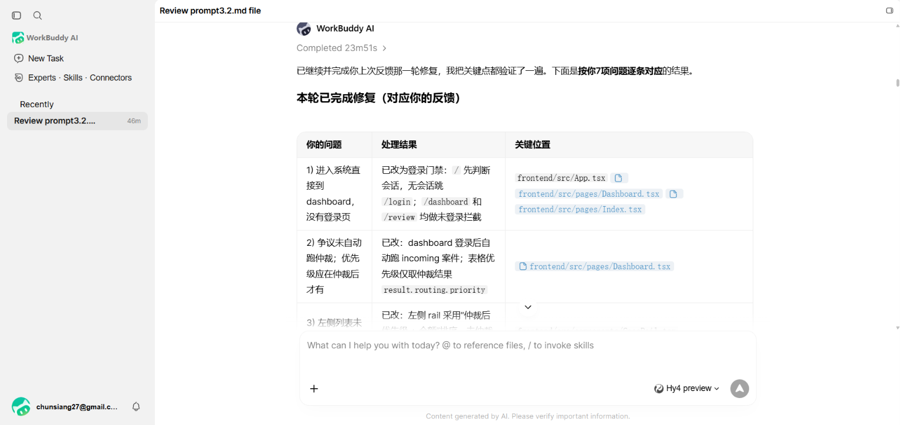
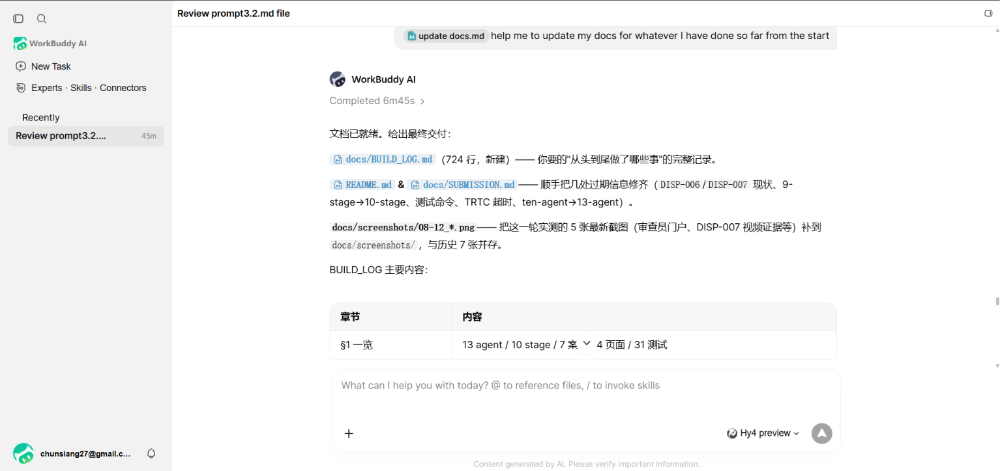

# Hackathon submission sheet — RYsolve

## Project title
**RYsolve**

## Short blurb
> Multi-agent autonomous dispute resolution for ride-hailing.

## Project description

### Project overview
- **Target scenario:** thousands of dispute tickets per day on ride-hailing
  platforms — no-show charges, route deviations, property damage.
- **Target users:** rider and driver support organisations, marketplace
  operations teams.
- **Value proposition:** replace 24–72 hour human review with sub-second
  multi-agent arbitration that is auditable, consistent and explicitly
  hands off to a human when the evidence is thin.

### Real-world scenario insights
- **Pain point:** 24–72 hour resolution times, millions spent on human
  support, inconsistent rulings between agents, user churn from perceived
  unfairness.
- **Target audience:** every ride-hailing marketplace (Ryde, Gojek, Grab,
  Uber, Lyft, Ola) and any other multi-party marketplace with dispute
  resolution (food delivery, parcel, freelancer platforms).
- **Core problems solved:** slow resolution, inconsistent rulings,
  opacity, scalability.

### Comprehensive solution design
- **Business architecture:** 13-agent / 10-stage arbitration pipeline
  (intake → SLA routing → **TRTC media ingestion (ASR + keyframes)** →
  evidence + collection + fraud + precedent in parallel → vision →
  parallel rider/driver advocates → judge → escalation gate) with a
  human-in-the-loop override that feeds a learning loop.
- **Technical architecture:** pure Python 3.11 + FastAPI + Pydantic v2 +
  httpx; React 19 + Vite + shadcn/ui console. Tencent Cloud TRTC for ASR
  (with a deterministic simulated client fallback) and `ffmpeg-python` for
  keyframe extraction. Tencent Cloud ADP for inference (with a deterministic
  offline reasoner fallback so the demo works without credentials).
  Reviewer Portal secured with Bearer-token auth on all approve/override
  endpoints. Upload endpoints validate magic bytes and enforce a 50 MB
  size cap. Precedent knowledge base uses atomic write-to-temp-then-rename
  persistence so a crash never corrupts the KB.




- **How prompts drive AI generation:** every agent system prompt pins
  its model call to a strict JSON output contract; the LLM is *only*
  allowed to argue over facts that Python already computed, never to
  invent them. The deterministic reasoning engine is A/B-comparable to
  the model output for a Responsible-AI baseline.
- **Autonomy boundary:** SLA priority decides the queue, the fraud and
  precedent agents feed the judge as context, and confidence below 70%
  (or any safety incident) hands the case to a human with a full
  escalation packet. Safety ASR transcripts override the autonomy
  threshold under policy `SAFETY-2`.

### Business value
- Cuts average resolution time from 24–72 hours to **< 1 second** for
  the autonomous path.
- **Consistent** rulings: same evidence → same verdict, always
  (verifiable from the evidence packet).
- **Auditable** to any rider or driver: every fact is tagged with its
  source and the party it supports.
- **Safe** by construction: confidence below 70% (or any safety
  incident) is escalated to a human reviewer — the system never rules
  autonomously when unsure.
- **Improves over time:** every human override is written back as a
  precedent, so tomorrow's ruling on an analogous case is measured
  against what the reviewer actually decided.
- Implementation is **swappable**: drop in any LLM/agent framework
  the team prefers (LangChain, AutoGen, CrewAI, or a custom client).
  Our `LLMProvider` protocol is the seam.

## Working prototype

End-to-end FastAPI + React console handling **four distinct dispute
categories** across **seven sample cases** (`backend/cases.py`).
The full demo flow is captioned under
[Demo flow](#demo-flow-link-in-docsscreenshots) below.

| Case ID | Dispute type | Key evidence | Expected ruling |
| --- | --- | --- | --- |
| `DISP-001` | `route_deviation`         | GPS route + chat-timer screenshot   | PARTIAL REFUND |
| `DISP-002` | `no_show_charge`          | GPS wait + contact log              | **CHARGE UPHELD** (88%) |
| `DISP-003` | `property_damage`         | Back-seat photo (clean)             | NO ACTION + fraud flag |
| `DISP-004` | `property_damage`         | Back-seat photo (genuine spill)     | COMPENSATE DRIVER |
| `DISP-005` | `safety_incident`         | Customer-support transcript         | ESCALATE (CRITICAL) |
| `DISP-006` | `safety_incident`         | 42 s in-app audio (AC argument)     | ESCALATE — TRTC ASR |
| `DISP-007` | `safety_incident`         | 12 s covert cabin video             | ESCALATE — keyframes + suspend driver |

How to run:

```bash
cd backend && python3 -m uvicorn main:app --port 3000          # API
cd frontend && pnpm dev                                        # console (Vite proxies /api)
# or build once and serve everything from FastAPI on one port:
cd frontend && pnpm build && cd ../backend && python3 -m uvicorn main:app --port 3000
```

Open <http://localhost:3000>, sign in as `reviewer / reviewer`, pick any
dispute, click **Run arbitration**, and watch the 10-stage pipeline emit
events on the SSE stream while the Evidence / Risk / Advocates / Verdict
panels populate.




## CodeBuddy / WorkBuddy conversation history




## Demo flow (link in `/docs/screenshots/`)
1. `01_disp003_verdict.png` — property damage with a fabricated photo,
   vision agent rejects evidence, ruling = NO ACTION + escalation to
   Fraud & Safety.
2. `02_disp002_verdict.png` — the official hackathon sample: no-show
   charge, ruling = **CHARGE UPHELD** at 88% confidence, every
   policy clause satisfied.
3. `03_evidence_panel.png` — auditable evidence extracted in pure
   Python, every fact tagged with source and `supports` party.
4. `04_arguments_panel.png` — the two advocates, with **declared
   weaknesses** for adversarial honesty.
5. `05_full_pipeline_stream.png` — the live inter-agent
   communication feed (the observability requirement).
6. `06_disp006_audio.png` — TRTC ASR pipeline: the in-app safety
   recording is transcribed into 3 turns (rider / rider / driver) on cabin
   temperature, the case is flagged `escalated` and the judge references
   the transcript in `key_findings`. The transcript is driven by the
   sidecar `disp006_arguement.txt` next to the MP3.
7. `07_disp007_video.png` (and `09_disp007_video_evidence.png`) — Vision
   Agent upgrade: a 12 s low-light covert cabin recording is decomposed
   into 12 keyframes at 1 fps; the case is CRITICAL and the ruling
   recommends instant driver suspension, a priority safety ticket and a
   law-enforcement referral.
8. `08_reviewer_portal_dashboard.png` — the new Reviewer Portal: KPI
   cards (Escalated / Critical / Awaiting review / Closed & Archived),
   the New/Archived tabs, the "Action Required: Escalated Cases"
   section, and the SLA pills at the top.

## Demo walkthrough video
> **Live demo** 
> ```markdown
> 
> ```

## Project link
- **Live deployment (reviewer portal):**
  <https://a3e35f2feabc741ad.sg.agentos-app.run>
  — single-port FastAPI + built React console; health at
  `/api/health`, open the root URL and log in with `reviewer / reviewer`.
- **Source code:** <https://github.com/YeowChunSiang/ryde-agent>
- **Local run:**
  ```bash
  cd backend && python3 -m uvicorn main:app --port 3000        # API + static console
  # or for hot-reload:
  cd frontend && pnpm dev                                      # Vite proxies /api → :3000
  ```
